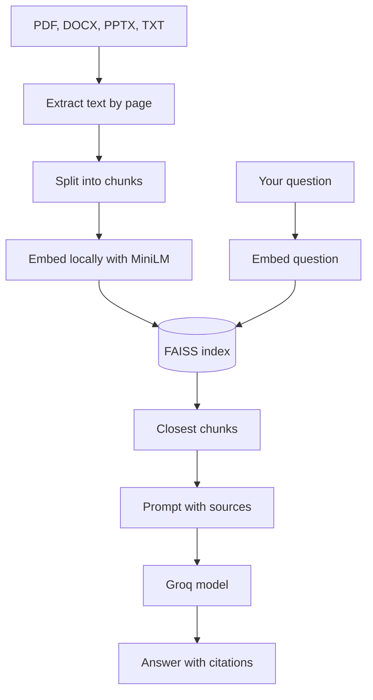

# 

Ask questions about your own documents and get answers that cite the exact file and page.

## 

Upload one or more PDFs, Word files, PowerPoint decks or text files, then ask questions in plain
language. Docent finds the *passages* that are actually relevant and asks a *language model* to answer
using only those passages. Every answer points back to its source, like
`[Source: report.pdf, page 4]`, so you can check it.

The search part runs on your own computer. Only the final question and the matching passages are
sent to the language model (Groq).

There are two ways to use it: a web app built with Next.js, or a simpler all-in-one Streamlit app.

## 

- Reads PDF, DOCX, PPTX and TXT, and remembers the page or slide each passage came from
- Answers only from your documents, with a *citation* for every claim
- Can focus on a single document or search all of them
- Remembers the conversation, so follow-up questions work
- Optional web search when you ask for it (for example "compare with the official documentation")
- Export a conversation as Markdown (Streamlit app)

## 

1. **Read:** text is pulled out of each file, page by page or slide by slide.
2. **Split:** the text is cut into small overlapping pieces (500 characters, 50 overlap).
3. **Embed:** each piece is turned into a *vector* with the `all-MiniLM-L6-v2` model, locally.
4. **Index:** the vectors go into a *FAISS* index. If FAISS isn't installed, a plain NumPy index is used
   instead.
5. **Answer:** your question is embedded the same way, the closest pieces are found, and they're
   sent to the model with instructions to answer only from them and cite each source.

## 



Both the Next.js app (through the FastAPI server) and the Streamlit app use this same pipeline.

## 

<p align="center">
  
  
  
  
  
  
  
  
  
</p>

| Layer | Technology |
|---|---|
| API | Python, FastAPI |
| Search | sentence-transformers (all-MiniLM-L6-v2), FAISS, LangChain text splitters |
| Language model | Groq, Llama 3.3 70B, through the OpenAI-compatible API |
| Reading files | pypdf, python-docx, python-pptx |
| Interfaces | Next.js, React, Tailwind CSS, React Bits; Streamlit |

## 

You need Python 3.10+, Node.js 20+ (for the web app) and a free Groq API key from
[console.groq.com](https://console.groq.com).

```bash
git clone https://github.com/Iamshi-vissa/Docent.git
cd Docent
python -m venv venv
source venv/bin/activate          # Windows: .\venv\Scripts\Activate.ps1
pip install -r requirements.txt
cp .env.example .env              # then paste your GROQ_API_KEY into .env
```

The first run downloads the *embedding* model (about 90 MB).

### 

Start the API in one terminal:

```bash
uvicorn api:app --host 127.0.0.1 --port 8000 --reload
```

Start the web app in a second terminal:

```bash
cd next-app
npm install
npm run dev
```

Open <http://localhost:3000>.

### 

```bash
streamlit run app.py
```

Open <http://localhost:8501>.

## 

Put these in `.env`:

| Variable | Needed | What it does |
|---|---|---|
| `GROQ_API_KEY` | yes | Your Groq API key |
| `GROQ_MODEL` | no | Model name, default `llama-3.3-70b-versatile` |

## 

| Endpoint | What it does |
|---|---|
| `POST /api/upload` | Add a document |
| `POST /api/query` | Ask a question |
| `GET /api/documents` | List loaded documents |
| `POST /api/reset` | Clear everything |
| `GET /api/health` | Check the API is running |

Interactive docs are at <http://localhost:8000/docs>.

## 

```
api.py           FastAPI server used by the web app
app.py           Streamlit app
ingest.py        reading files, splitting and indexing
retriever.py     finding the most relevant passages
chat.py          building the prompt and calling Groq
web_search.py    optional web search
styles.py        Streamlit styling
next-app/        Next.js web app
```

## 

Works end to end with both interfaces. Things worth improving:

- There are no automated tests yet
- Documents are kept in memory, so they're lost when the API restarts
- The web app has the API address (`http://localhost:8000`) hard-coded; it should come from a
  setting so it can be deployed

## 

- P. Lewis et al., "Retrieval-Augmented Generation for Knowledge-Intensive NLP Tasks", NeurIPS 2020
- N. Reimers and I. Gurevych, "Sentence-BERT: Sentence Embeddings using Siamese BERT-Networks",
  EMNLP 2019
- [FAISS](https://faiss.ai/) and the
  [all-MiniLM-L6-v2 model card](https://huggingface.co/sentence-transformers/all-MiniLM-L6-v2)

## 

MIT. See [LICENSE](LICENSE).
